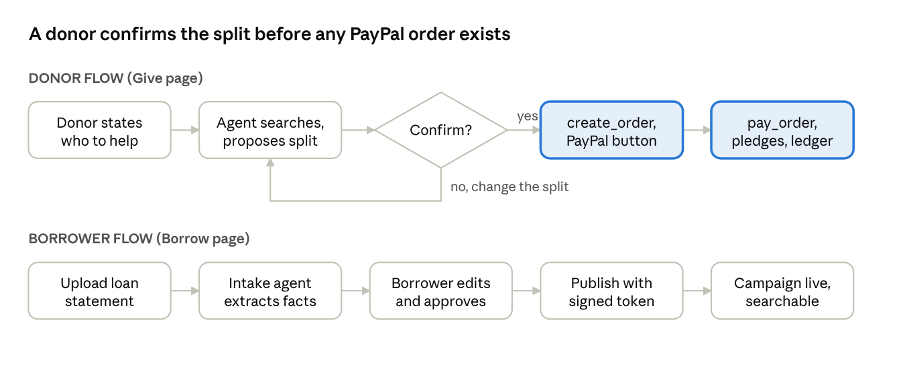
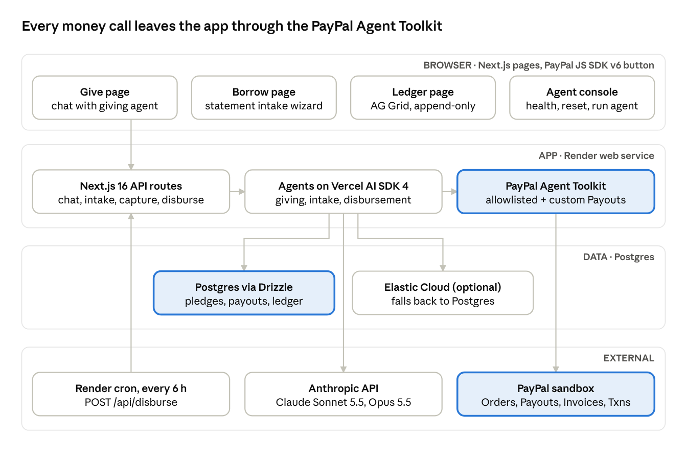
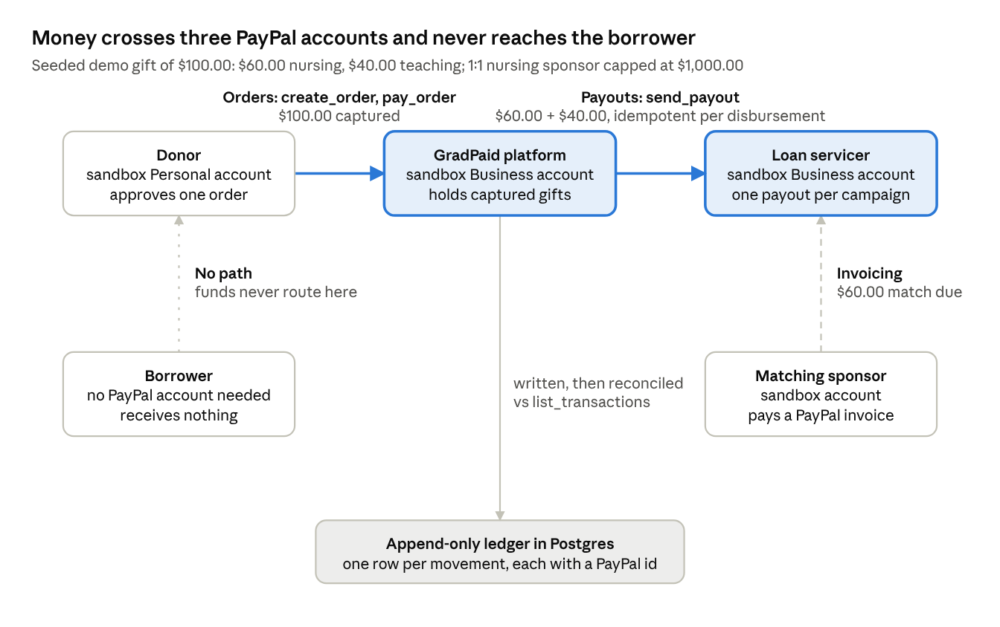
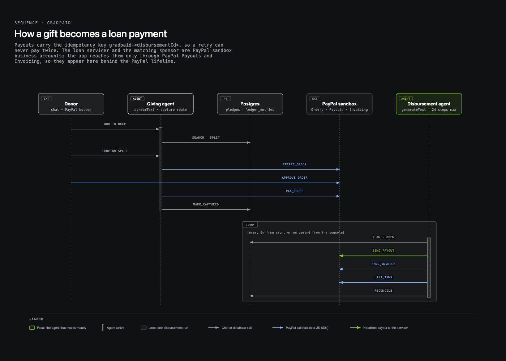
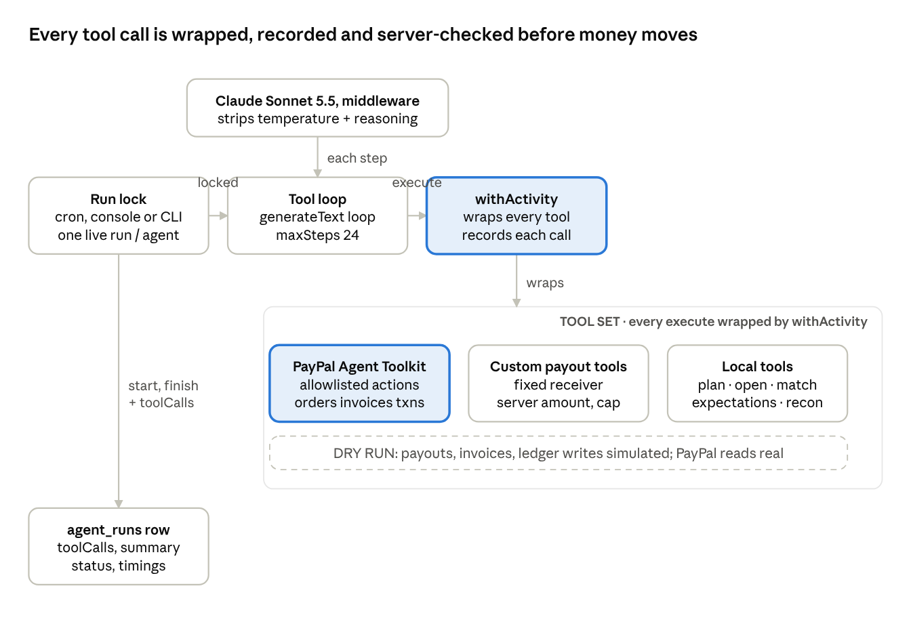
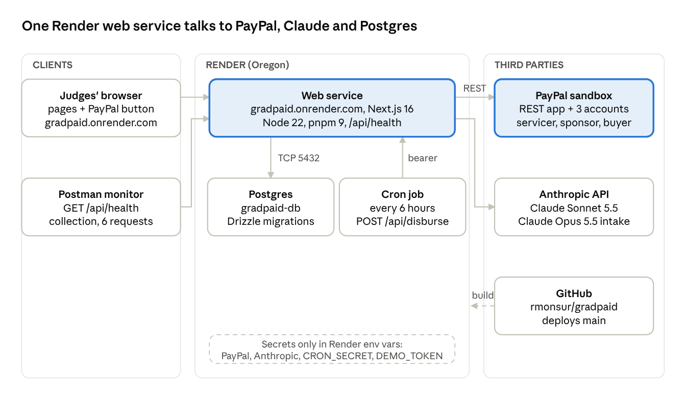

# How GradPaid works, in diagrams

Companion to the Claude Doc "diagram" (https://claude.ai/artifact/8FX5exBNeNtxKS1EhSvR3u), where the
drawings can be edited and commented in place. Brand-styled HTML versions drawn with the diagram-design
skill sit beside this file in `diagrams/`, and `diagrams/money-path/index.html` is an interactive
isometric figure of the same money path.

GradPaid is crowd-repayment for student debt where every dollar is moved by an AI agent calling PayPal
through the PayPal Agent Toolkit, and the borrower never touches the money.

## Agentic use cases

Three agents run on Claude through the Vercel AI SDK, each with its own PayPal Agent Toolkit instance
scoped to an allowlist of actions. The model chooses when to call a tool; the server decides every amount
and recipient.

| Agent              | Trigger                            | Toolkit tools                                                               | Custom and local tools                                                                                                                          | Server guard                                                                                                 |
| ------------------ | ---------------------------------- | --------------------------------------------------------------------------- | ----------------------------------------------------------------------------------------------------------------------------------------------- | ------------------------------------------------------------------------------------------------------------ |
| Intake agent       | Borrower uploads a statement       | none                                                                        | report_loan_facts, submit_campaign_draft                                                                                                        | Facts are HMAC-signed; publishing rejects edited facts or a goal above the balance                           |
| Giving agent       | Donor chats on Give                | create_order, get_order                                                     | search_campaigns, propose_split, record_donation_order                                                                                          | Order is read back and must match the split; capture is checked for amount and currency                      |
| Disbursement agent | Cron every 6 h, Agent console, CLI | list_transactions, create_invoice, send_invoice, get_invoice, create_refund | open_disbursement, send_payout, get_payout_batch, get_sponsor_match_due, record_sponsor_invoice, get_ledger_expectations, record_reconciliation | Amount from pledges, fixed receiver, serialized sends under a cap, invoice read back, one live run per agent |

## User flows

## Tech stack and architecture

Next.js 16, Vercel AI SDK 4.3 with @ai-sdk/anthropic, @paypal/agent-toolkit 1.11, PayPal JS SDK v6,
Postgres with Drizzle, Elastic with a Postgres fallback, AG Grid 36, Render, Postman, Vitest.

## Flow of funds

| Movement         | PayPal product     | Toolkit call                                            | Pays                   | Receives          | Ledger row                      |
| ---------------- | ------------------ | ------------------------------------------------------- | ---------------------- | ----------------- | ------------------------------- |
| Donation         | Orders v2          | create_order, then pay_order                            | Donor (Personal buyer) | GradPaid platform | donation_captured, per campaign |
| Servicer payment | Payouts            | send_payout, custom, key gradpaid-<disbursementId>      | GradPaid platform      | Loan servicer     | servicer_payout                 |
| Sponsor match    | Invoicing v2       | create_invoice, send_invoice, verified with get_invoice | Matching sponsor       | GradPaid platform | sponsor_invoiced, sponsor_paid  |
| Reconciliation   | Transaction Search | list_transactions against get_ledger_expectations       | none                   | none              | reconciled, exception           |

## How a gift becomes a loan payment

## Why PayPal's AI integration is the keystone

- One shape for every money action: toolkit tools and the custom Payouts tools are called the same way as
  local tools, so the agent treats a payout like any other PayPal call.
- Allowlists are the first guard: each agent only sees the actions it needs.
- PayPal is the source of truth, not the model: orders, captures and invoices are read back before they are
  recorded, and every run ends by comparing the ledger with list_transactions.
- Visible to judges: every toolkit call is shown live with its request, response and PayPal id.
- Gaps documented: Payouts is wrapped as a custom tool; Transaction Search must be enabled on the app;
  real servicers do not accept PayPal, so the servicer is a sandbox business account.

## Agent harness

## Deployment

